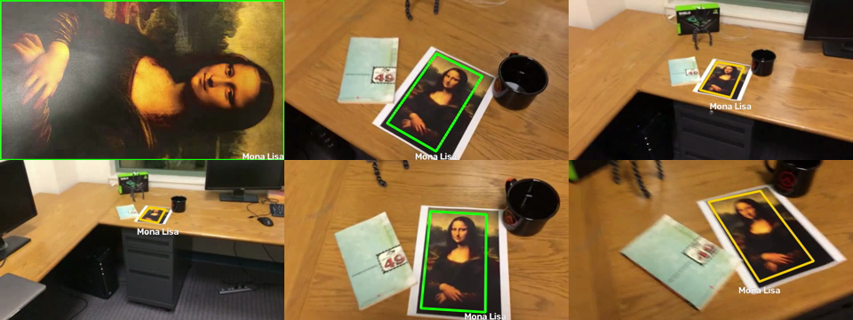
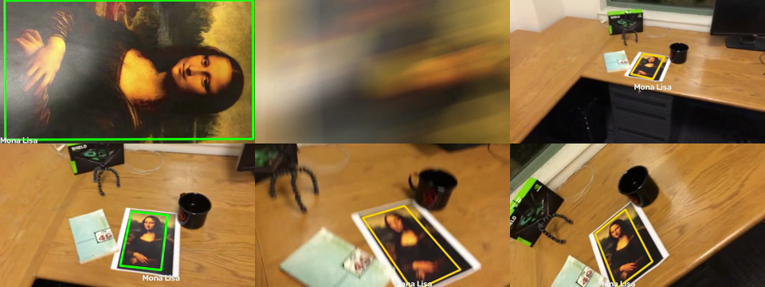
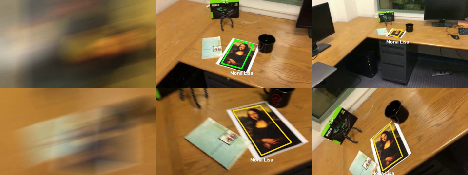
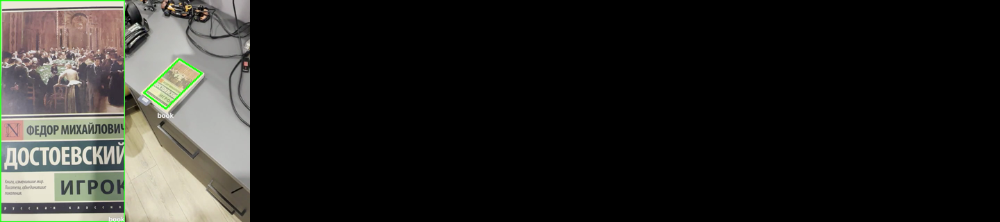

# Лабораторная работа №2. Трекинг объекта на видео по ключевым точкам

**Цель работы:** реализовать простейший алгоритм трекинга объекта на видео на основе ключевых точек.

**Задание:** программа получает видео, первый кадр которого - крупное изображение объекта. На каждом кадре, где объект виден, вокруг него рисуется рамка с подписью. Объект плоский и прямоугольный, поэтому рамка должна как можно точнее совпадать с его реальными границами. Алгоритм нужно проверить на трёх тестовых видео и на собственном видео с похожим объектом.

## 1. Теоретическая база

### Ключевые точки и дескрипторы

Сравнить объект на разных кадрах напрямую, пиксель в пиксель, нельзя: он сдвигается, поворачивается, меняет размер и виден под разными углами. Поэтому на изображении ищутся ключевые точки - характерные места вроде углов, пятен и резких перепадов яркости, которые можно однозначно найти снова на другом кадре. На однородных участках таких точек нет, поэтому для трекинга выбираются объекты с разнообразной текстурой.

Для каждой ключевой точки вычисляется дескриптор - числовое описание её окрестности. Дескриптор строится так, чтобы почти не меняться при повороте, масштабировании и изменении освещения. Тогда одну и ту же точку можно узнать на разных кадрах, сравнивая дескрипторы.

В работе используется алгоритм SIFT. Он ищет точки как экстремумы разности гауссиан на нескольких масштабах изображения и описывает каждую точку вектором из 128 чисел - гистограммами направлений градиента в окрестности, повёрнутой по главному направлению точки.

### Сопоставление точек

Чтобы найти объект на кадре, дескрипторы эталона сравниваются с дескрипторами кадра: для каждой точки эталона ищется точка кадра с наименьшим евклидовым расстоянием между дескрипторами.

Часть найденных пар оказывается ошибочной, особенно на повторяющихся текстурах. Для их отсева применяется тест отношения Лоу: для каждой точки ищутся два ближайших соседа, и пара принимается, только если лучший сосед заметно ближе второго. Если два кандидата одинаково похожи, точка неоднозначна и отбрасывается.

### Гомография

Два изображения одной плоскости, снятые с разных положений камеры, связаны гомографией - перспективным преобразованием, которое задаётся матрицей 3×3 и описывает сдвиг, поворот, масштаб и перспективное искажение. Зная гомографию между эталоном и кадром, можно перенести на кадр любую точку эталона, в том числе его четыре угла. Так получается рамка, которая повторяет положение и наклон объекта. Это верно только для плоских объектов, поэтому в задании объект плоский.

Гомография определяется по четырём парам соответствующих точек. Пар обычно сотни, и часть из них ошибочна, поэтому применяется оценка: многократно выбираются случайные четвёрки пар, по каждой строится гомография, и считается, сколько остальных пар с ней согласно, то есть после переноса попадает не дальше заданного порога от найденной точки. Побеждает гомография с наибольшим числом согласных пар. Верные пары описывают одно и то же движение объекта и подтверждают друг друга, а ошибочные разбросаны случайно.

### Оптический поток

Когда объект далеко или кадр смазан, дескрипторы на кадре сильно отличаются от эталонных, и сопоставление не находит достаточно пар. В этом случае можно сравнивать кадр не с эталоном, а с предыдущим кадром: соседние кадры разделяет 1/30 секунды, и объект на них выглядит почти одинаково.

Оптический поток - смещение точек изображения между соседними кадрами. Метод оценивает смещение точки, предполагая, что яркость в небольшом окне вокруг неё сохраняется и всё окно сдвигается одинаково.

## 2. Описание разработанной системы

Программа написана на Python и находится в файле `main.py`. Используются OpenCV 5 и NumPy.

### Общая схема

Эталоном служит первый кадр видео. Для каждого следующего кадра программа ищет гомографию «эталон → кадр» одним из двух способов:

- **детекция** - объект находится заново сопоставлением ключевых точек с эталоном. Не зависит от прошлых кадров и исправляет накопленные ошибки. Рамка рисуется зелёной;
- **сопровождение** - положение объекта с прошлого кадра сдвигается по оптическому потоку. Работает, когда объект мал или смазан, но опирается на прошлый результат. Рамка рисуется жёлтой.

По найденной гомографии четыре угла эталона переносятся на кадр, получившийся четырёхугольник проверяется на правдоподобие и рисуется вместе с подписью.

### Подготовка эталона (`Detector.__init__`)

На эталоне ищутся точки SIFT. Порог контраста снижен с 0,04 до 0,01: тестовый объект тёмный и малоконтрастный.

Независимость SIFT от масштаба на практике ограничена: когда объект в кадре в 5-10 раз меньше эталона, мелкие детали эталона в кадре уже не видны. Поэтому эталон дополнительно уменьшается до 70, 50, 35, 25 и 18 % от исходного размера, и точки ищутся на каждой копии. Координаты всех точек пересчитываются в масштаб исходного эталона, а дескрипторы объединяются в одну таблицу. Получается эталон, по которому объект узнаётся и вблизи, и издалека.

### Детекция (`Detector.find`)

1. На кадре ищутся точки SIFT.
2. Для каждой точки эталона FLANN находит двух ближайших соседей на кадре, затем применяется тест Лоу с порогом 0,75.
3. По оставшимся парам методом MAGSAC с порогом 5 пикселей оценивается гомография.
4. Если inliers меньше 10, объект считается не найденным. Детекция с 10-39 inliers считается слабой, с 40 и более - уверенной.

### Сопровождение (`Tracker.seed`, `Tracker.follow`)

Сопровождение используется, только когда детекция не справилась. Точки для слежения должны лежать на объекте, а отметить их можно лишь на кадре, где положение объекта известно. Поэтому после каждой успешной детекции внутри рамки детектором отмечается до 300 точек, даже если на следующем кадре они не понадобятся.

Если на следующем кадре сопровождение всё же нужно:

1. Точки отслеживаются методом Лукаса-Канаде. Точки, вернувшиеся дальше чем на 1 пиксель от исходного места, отбрасываются.
2. По оставшимся точкам методом RANSAC оценивается аффинное преобразование прошлый `кадр -> текущий`.
3. Гомография прошлого кадра умножается на это преобразование, получается гомография `эталон -> текущий кадр`.
4. Когда точек остаётся меньше половины от отмеченных, отмечаются новые.

Между кадрами оценивается именно аффинное преобразование, а не полная гомография. На объекте размером в несколько десятков пикселей перспективная часть гомографии по точкам почти не определяется, и в первой версии программы рамка в таких случаях «улетала» на полкадра. Аффинное преобразование устойчиво, а перспектива за 1/30 секунды почти не меняется.

### Проверка рамки (`is_valid_quad`, `is_consistent`)

Четырёхугольник, полученный из гомографии, отбрасывается, если:

- он невыпуклый или его площадь меньше 100 пикселей;
- его углы выходят дальше чем на размер кадра за его пределы;
- противоположные стороны отличаются больше чем в 3 раза;
- какой-либо угол меньше 35° или больше 145°;
- его площадь изменилась больше чем в 1,6 раза по сравнению с прошлым кадром.

Последняя проверка применяется к слабым детекциям и к сопровождению, но не к уверенной детекции. Иначе после ошибки сопровождения программа отбрасывала бы все последующие правильные детекции как несогласованные с ошибочной рамкой. Это происходило на собственном видео, когда камеру закрывала рука.

### Выбор результата на кадре (`Tracker.locate`)

1. Сначала всегда выполняется детекция.
2. Уверенная детекция с правдоподобной рамкой принимается сразу.
3. Если детекция не сработала или слабая, а на прошлом кадре объект был, выполняется сопровождение. Если оно дало правдоподобную рамку, принимается она, иначе принимается слабая детекция.
4. Если не сработало ничего, объект считается потерянным, и сопровождение сбрасывается до следующей детекции.
5. После каждой принятой детекции точки для сопровождения отмечаются заново.

### Запуск

Зависимости устанавливаются через uv:

```bash
uv sync
uv run main.py test-videos/book.mp4 --label "book" --show --timeline
```

- `--show` - показывать кадры в окне во время обработки (`q` - выход);
- `--label` - подпись у рамки;
- `--timeline` - вывести, каким способом найден объект на каждом кадре: `#` - детекция, `~` - сопровождение, `.` - объект потерян.

Видео с рамками сохраняются в папку `results`.

## 3. Результаты работы и тестирования

### Тестовые видео

В двух вариантах видео c картиной добавлено размытие в движении, в варианте extra-credit - сильнее.

**mona-lisa.mp4**



**mona-lisa-blur.mp4**



**mona-lisa-blur-extra-credit.mp4**



### Собственное видео

Объект - обложка книги, видео вертикальное. В видео есть отъезд камеры, обход объекта, съёмка под углом, перекрытие объекта рукой, закрывающей камеру.



### Итоговые показатели

| Видео | Кадров | Объект найден | Детекция | Сопровождение | Потерян | Скорость, кадр/с |
|---|---|---|---|---|---|---|
| mona-lisa | 558 | 558 (100 %) | 291 | 267 | 0 | 9,2 |
| mona-lisa-blur | 558 | 539 (96,6 %) | 271 | 268 | 19 | 8,3 |
| mona-lisa-blur-extra-credit | 558 | 530 (95,0 %) | 244 | 286 | 28 | 8,0 |
| book | 980 | 970 (99,0 %) | 867 | 103 | 10 | 8,4 |

## 4. Выводы

В работе реализован трекер плоского объекта на видео на основе ключевых точек. Объект находится сопоставлением точек SIFT с эталоном и оценкой гомографии. Рамка получается переносом углов эталона гомографией и повторяет перспективу объекта.

Одна детекция по ключевым точкам находит объект только при крупном и резком изображении. Основные трудности - малый размер объекта и размытие в движении. Многомасштабный эталон частично решает первую проблему. Обе проблемы решает сопровождение оптическим потоком между соседними кадрами, использующее то, что соседние кадры почти одинаковы. В итоге объект находится почти во всех кадрах тестовых видео.

Сочетание двух способов требует проверок. Сопровождение опирается на прошлый результат и переносит его ошибки, поэтому каждая рамка проверяется на геометрическую правдоподобность, а уверенная детекция всегда имеет приоритет над сопровождением. На маленьком объекте между кадрами устойчивее оценивать аффинное преобразование, а не полную гомографию.